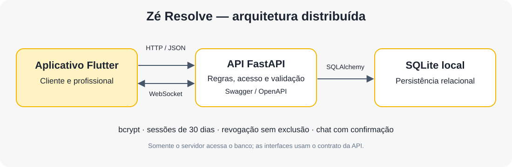
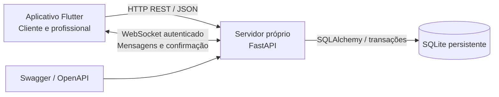
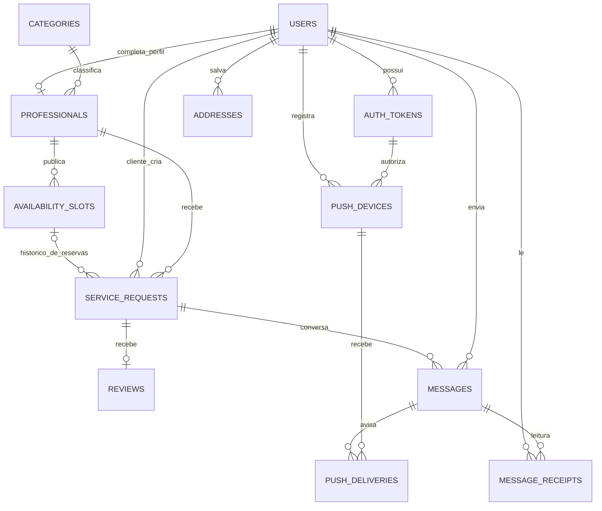
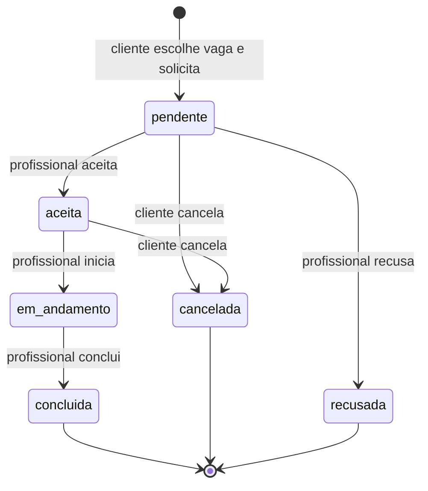

# Zé Resolve — arquitetura distribuída

O Flutter contém as telas e módulos reutilizáveis de comunicação. A API centraliza
validação, regras de negócio, autorização e persistência. Apenas o servidor abre
o banco. O contrato permite acrescentar um painel independente; a interface
entregue neste repositório é o aplicativo Flutter.

## Modelo relacional

| Entidade | Campos e integridade |
| --- | --- |
| `users` | ID, nome, email único normalizado, telefone, perfil cliente/profissional e hash bcrypt. Perfil imutável pela API. |
| `auth_tokens` | Hash de token aleatório, usuário, emissão, expiração original, expiração efetiva e revogação. Várias sessões independentes por usuário. |
| `categories` | ID e nome único, mantidos pelo servidor. |
| `professionals` | ID vinculado ao usuário, categoria, descrição pública, cidade, valor fixo da visita em centavos e pausa geral. A tarifa por hora é mantida somente como dado legado, sem conversão automática. |
| `availability_slots` | Profissional proprietário, início/fim em UTC, ativo e criação. Publicação de vagas futuras sem sobreposição; arquivamento sem exclusão. |
| `service_requests` | Cliente e profissional diferentes; vaga escolhida, horário/duração derivados da agenda, valor da visita preservado, título, descrição, endereço, estado e criação. Campos de vaga/visita podem ser nulos no histórico legado. |
| `reviews` | Uma avaliação por solicitação; nota inteira de 1 a 5, comentário e criação. Somente cliente proprietário, após conclusão. |
| `messages` | Solicitação, remetente, texto e criação; remetente participante. Identificador único por remetente evita duplicação de reenvios pelo WebSocket. |
| `addresses` | Proprietário, apelido, endereço completo, padrão e ativo; arquivamento sem exclusão. Dados privados. |
| `message_receipts` | Usuário, mensagem e data de leitura; chave composta torna a marcação idempotente. |
| `push_devices` | Dispositivo privado ligado ao usuário e à sessão; inativação no logout ou troca de senha. |
| `push_deliveries` | Fila persistente por mensagem e dispositivo, tentativas, reserva de processamento e resultado. |
| `auth_attempts` | Limites persistentes de autenticação por identificadores derivados, sem armazenar IP/email legível. |
| `data_protection_metadata` | Marcador autenticado para verificar a chave e versão da migração; não contém a chave. |

O banco aplica chaves estrangeiras, `UNIQUE` e `CHECK`. O servidor aplica regras
de perfil, propriedade, data futura e etapa. Datas usam UTC; a interface mostra
o horário local. Valores monetários são inteiros em centavos. O schema SQL está
em [schema.sql](schema.sql).

## Escolha do banco

SQLite é relacional e oferece transações, chaves estrangeiras, índices e constraints em um arquivo persistente. Foi escolhido para a apresentação local no Windows porque acompanha o Python e dispensa instalar ou iniciar um serviço de banco. SQLAlchemy centraliza as entidades e consultas; o Flutter acessa somente a API.

O arquivo `backend/data/apresentacao.db` permanece disponível após reiniciar o servidor. WAL e transações coordenam leituras/escritas; o índice único parcial evita duas reservas ocupantes na mesma vaga. A configuração é de apresentação local, sem promessa de escalar para vários servidores. Veja [SQLite e backup](sqlite.md).

## REST em relação a SOAP

REST representa recursos por URLs, usa métodos HTTP e códigos padronizados e,
neste projeto, transporta JSON. Isso facilita o consumo pelo Flutter e outras
interfaces, com contrato documentado em OpenAPI. SOAP utiliza envelopes XML e
contratos normalmente expressos em WSDL, além de padrões como WS-Security.
Esses recursos são úteis em integrações corporativas específicas, mas trazem
complexidade desnecessária para o catálogo e os serviços do Zé Resolve. Usamos
REST para essas operações e WebSocket para o chat bidirecional.

## Fluxo principal

O pedido pendente já ocupa a vaga. Recusa ou cancelamento a libera; o aceite
confirma o atendimento. A taxa é referente à visita, sem definir o preço total
do reparo. Veja [agenda, preço e filtro de 24 horas](agenda_visitas.md).

Outro usuário ou perfil sem autorização recebe `403`; uma transição inválida
retorna `409`. A alteração compara o estado anterior no banco para proteger
contra concorrência. Avaliações só são permitidas uma vez, após conclusão.
Mensagens continuam disponíveis depois do encerramento do serviço.

## Senhas, sessões e retenção

Senhas usam **bcrypt com custo 12 e salt individual aleatório**. São aceitos no
mínimo 8 caracteres e no máximo 72 bytes UTF-8; valores maiores são rejeitados,
sem truncamento. Espaços nas senhas são preservados. Bcrypt é unidirecional e
serve para verificação de senha, não para recuperar nomes, endereços ou telefones.

Cada login gera um token aleatório de 256 bits com validade absoluta de **30 dias
corridos**, sem renovação por uso. No banco fica apenas seu hash SHA-256, adequado
para esse segredo de alta entropia. No dispositivo, token e expiração ficam no
armazenamento seguro; o aplicativo nunca salva a senha. Ao reabrir, o servidor
confirma a sessão. Uma falha de conexão permite tentar novamente sem descartar
automaticamente a sessão válida.

**Não há rotas DELETE, exclusões físicas ou limpeza automática de registros.**
Logout antecipa `expires_at` para um instante anterior ao atual e preenche
`revoked_at`, conservando `issued_at` e `original_expires_at`. Sessões naturalmente
expiradas também ficam no banco. Serviços são cancelados ou recusados por mudança
de estado; mensagens e avaliações mantêm seus vínculos. Remover o token do
dispositivo ao sair não apaga a linha de sessão do servidor.

No WebSocket, a sessão e os participantes são revalidados durante a conexão.
O token vai no primeiro frame, nunca na URL. Origins de browsers são validados
separadamente, pois CORS se aplica ao HTTP. O servidor envia ACK depois do commit;
identificadores de envio impedem duplicatas após timeout. O histórico permite
retomar do último ID recebido. O servidor consulta novos registros a cada 500 ms
e os entrega pelo socket, inclusive entre conexões de processos diferentes que
acessam o mesmo arquivo SQLite. Para escala maior, um broker pode substituir essa
consulta interna sem mudar o contrato do aplicativo.

## Referências

- [FastAPI: CORS](https://fastapi.tiangolo.com/tutorial/cors/)
- [FastAPI: WebSocket](https://fastapi.tiangolo.com/advanced/websockets/)
- [bcrypt](https://pypi.org/project/bcrypt/)
- [Flutter Secure Storage](https://pub.dev/packages/flutter_secure_storage)

Detalhes da criptografia de campos privados, limite de tentativas, cache e transporte estão em [seguranca.md](seguranca.md).

## Entidades de conta, notificações e integridade

| Entidade | Relação e integridade |
| --- | --- |
| `schema_revisions` | Identifica migrações aplicadas; API de produção apenas valida a revisão. |
| `account_actions` | Auditoria de suspensão, encerramento e ações de conta; ligada ao usuário. |
| `account_challenges` | Usuário, finalidade, digest do código, expiração e consumo único; código não retornado pela API. |
| `mail_deliveries` | Fila persistente de email com corpo cifrado, tentativas, lease e prazo. |
| `request_events` | Evento de solicitação para um destinatário, etapa e leitura. |
| `event_deliveries` | Evento e dispositivo, fila de push com tentativas e lease. |
| `socket_leases` | Usuário/sessão, validade renovável e encerramento; limita conexões concorrentes. |

`users` acrescenta atividade, confirmação de email, versão/aceite dos termos e encerramento. `service_requests` acrescenta prazo de reserva, motivo e autor do cancelamento. O DDL exportado descreve tipos, índices e constraints. Na apresentação local, a API cria e atualiza o schema ao iniciar. FCM e SMTP são integrações externas; regras e histórico permanecem centralizados na API e no SQLite.
