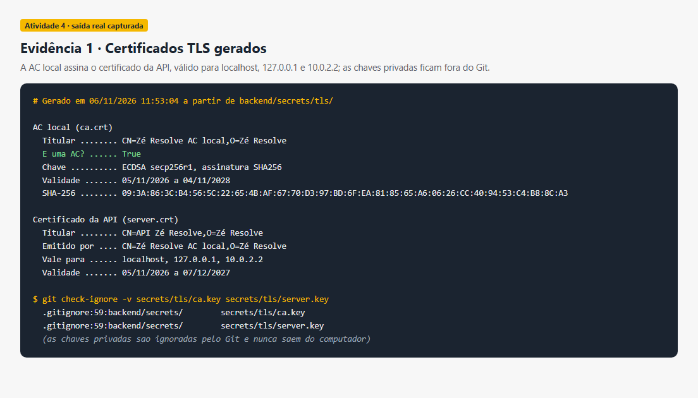
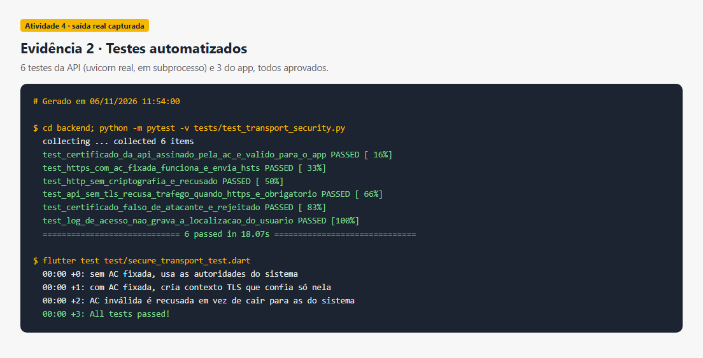
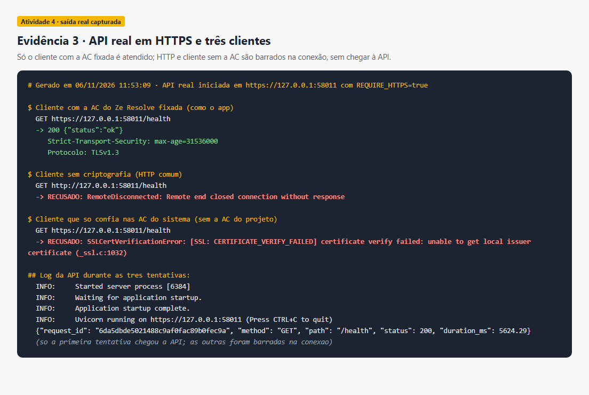
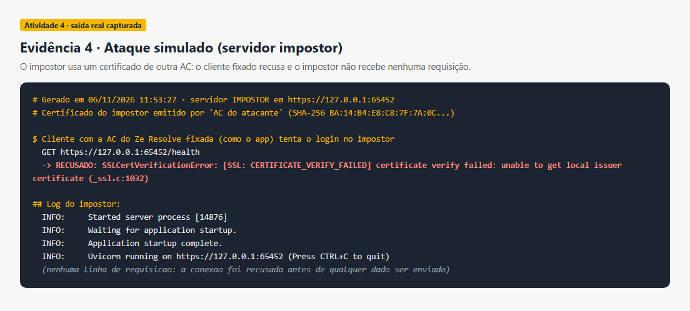
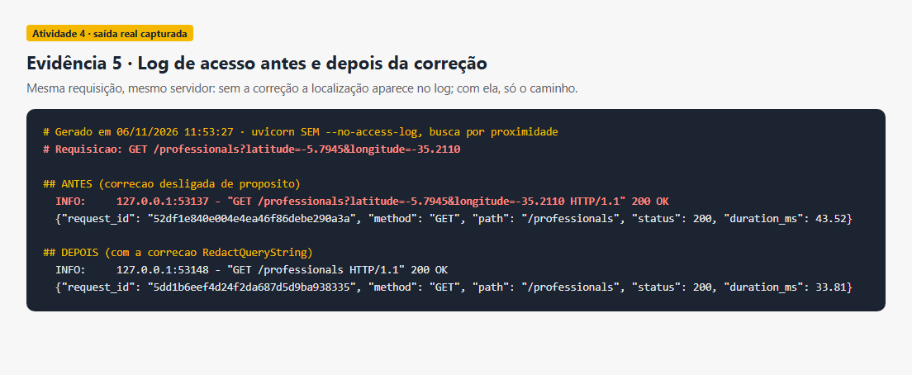
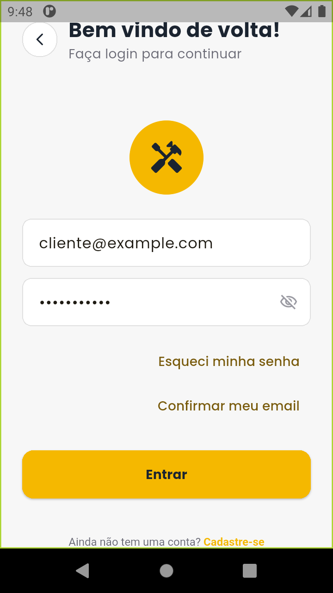
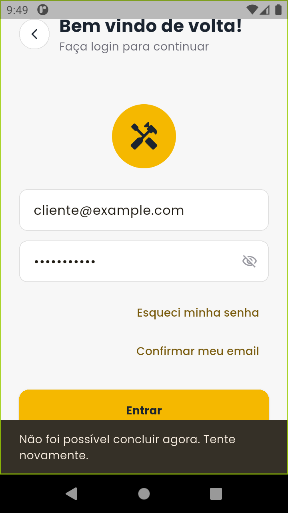
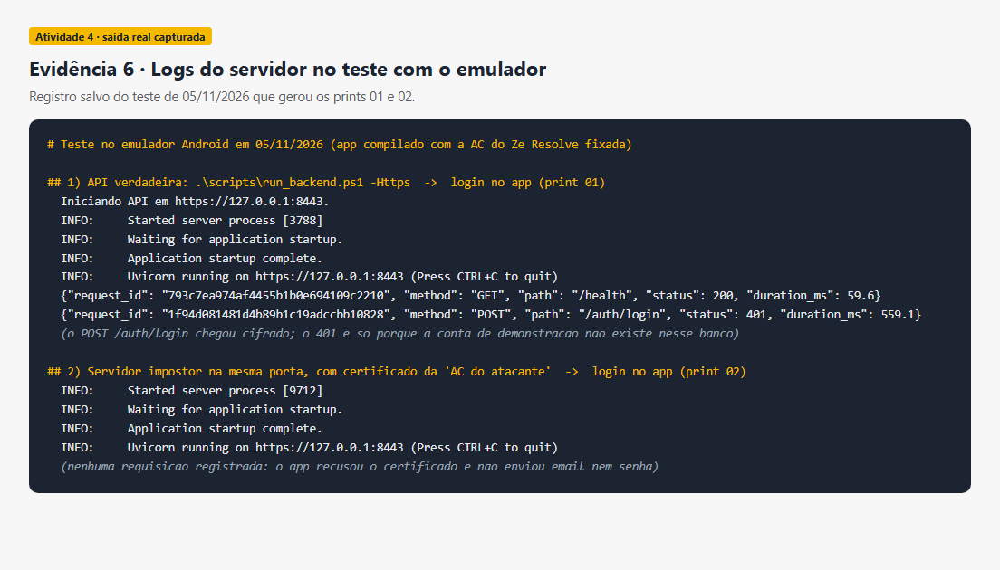

# Atividade 4 – Segurança da Informação no Aplicativo Zé Resolve

**Projeto Integrador II** · Aplicativo Flutter + API FastAPI · Branch `feat/seguranca-https`

O Zé Resolve conecta clientes a profissionais de serviços. O app troca com a API dados pessoais (nome, telefone, endereço, localização), o token de sessão e as mensagens do chat. A análise partiu do que o projeto já tinha (senhas com bcrypt, campos privados cifrados com AES-GCM, token guardado só como hash SHA-256, limite de tentativas de login, backups conferidos por SHA-256) e buscou o que ainda ficava exposto.

## Etapa 1 – Riscos identificados

### Risco 1 – Comunicação sem criptografia entre o app e a API

| | |
|---|---|
| **Ameaça** | Alguém na mesma rede do usuário (Wi-Fi público, da faculdade) intercepta o tráfego ou se coloca entre o app e a API ("homem no meio"). |
| **Vulnerabilidade** | A API só funcionava em HTTP e o WebSocket em `ws://`, sem TLS. A opção `REQUIRE_HTTPS` apenas recusava conexões; o servidor não sabia servir HTTPS. O app de desenvolvimento permite tráfego em texto claro (`usesCleartextTraffic="true"`). |
| **Impacto** | **Confidencialidade:** o token Bearer vale 30 dias; quem o captura entra na conta e lê endereço, pedidos e conversas. **Integridade:** um intermediário pode alterar respostas (preço, horário, status do pedido). |

### Risco 2 – Localização dos usuários gravada nos logs do servidor

| | |
|---|---|
| **Ameaça** | Quem tem acesso aos logs (outro usuário do computador, um backup, um print ou gravação de tela) descobre onde os clientes estão. |
| **Vulnerabilidade** | A busca por proximidade envia `latitude` e `longitude` na URL. A proteção dependia de lembrar a opção `--no-access-log`: o script do Windows a usava, mas o comando do README para Linux/macOS não. Sem ela, o uvicorn grava a URL completa. O próprio vídeo de demonstração do grupo mostra a linha `GET /professionals?latitude=...&longitude=...` no terminal. |
| **Impacto** | **Confidencialidade** de um dado pessoal (localização) protegido pela LGPD; contradiz a política do próprio projeto, que diz que os logs omitem query strings. |

## Etapa 2 – Mecanismos implementados

### 1. HTTPS/WSS com fixação de certificado (certificate pinning)

- **Autoridade certificadora local** (`backend/app/tls_setup.py`): gera uma AC do Zé Resolve e o certificado da API (ECDSA P-256, assinatura SHA-256), válido para `localhost`, `127.0.0.1` e `10.0.2.2` (emulador). As chaves privadas ficam em `backend/secrets/tls/`, fora do Git.
- **API em TLS** (`scripts/run_backend.ps1 -Https`): o uvicorn serve HTTPS e WSS na porta 8443 e liga `REQUIRE_HTTPS=true`. Requisições sem TLS são recusadas, e as respostas HTTPS enviam `Strict-Transport-Security`.
- **Fixação no aplicativo** (`lib/core/api/secure_transport.dart`): o app recebe só o certificado **público** da AC (`--dart-define=API_CA_CERT_B64`) e cria um `SecurityContext(withTrustedRoots: false)`, ou seja, confia **somente** nessa AC. O mesmo cliente é usado na API REST e nos dois WebSockets (chat e avisos). Um certificado de qualquer outra autoridade é recusado, mesmo que um atacante instale sua AC no celular.
- **Execução no aparelho** (`scripts/run_android_usb.ps1`): o modo HTTPS passou a ser o padrão; `-Http` mantém o modo antigo só para compatibilidade.

### 2. Correção da vulnerabilidade do log

- `RedactQueryString` (`backend/app/http_controls.py`) é instalado pela própria API no logger de acesso do uvicorn e remove tudo depois do `?`. O caminho continua registrado (`GET /professionals`), mas latitude e longitude nunca chegam ao log, **mesmo que o servidor seja iniciado sem `--no-access-log`**.
- O comando do README para Linux/macOS também recebeu `--no-access-log`.

## Etapa 3 – Testes e validação

Todas as evidências abaixo são a saída real dos comandos, capturada ao executá-los; as imagens 01 e 02 são prints do emulador.

### Teste 1 – Certificados gerados corretamente

**Objetivo:** confirmar que a AC local emitiu o certificado da API para os endereços usados pelo app, e que as chaves privadas não vão para o Git.
**Procedimento:** `.\scripts\run_backend.ps1 -Task tls` e leitura dos certificados gerados em `backend/secrets/tls/`.
**Resultado:** o certificado da API é emitido pela "Zé Resolve AC local", vale para `localhost`, `127.0.0.1` e `10.0.2.2`, usa ECDSA P-256 com SHA-256, e o Git ignora `ca.key` e `server.key`.

### Teste 2 – Testes automatizados

**Objetivo:** verificar de forma repetível cada comportamento do mecanismo.
**Procedimento:** `python -m pytest -v tests/test_transport_security.py` (cada teste sobe a API real com o uvicorn) e `flutter test test/secure_transport_test.dart`.
**Resultado:** **6 de 6** testes da API e **3 de 3** do app aprovados. A suíte completa passou com 70 testes da API e 114 do app.

| Teste | Objetivo | Resultado |
|---|---|---|
| Certificado assinado pela AC | O certificado da API é emitido pela AC, não é uma AC, e vale para `127.0.0.1` e `10.0.2.2` | Aprovado |
| HTTPS com AC fixada | Cliente que confia só na AC do projeto conecta, recebe `200` e o cabeçalho HSTS | Aprovado |
| HTTP recusado | Conexão sem TLS na porta HTTPS é derrubada | Aprovado |
| HTTPS obrigatório | API com `REQUIRE_HTTPS=true` responde `400` a HTTP comum | Aprovado |
| Certificado de atacante | Servidor com certificado de outra AC é rejeitado com `SSLCertVerificationError` | Aprovado |
| Log sem localização | `GET /professionals?latitude=...` aparece no log só como `GET /professionals` | Aprovado (contraprova no Teste 5) |

### Teste 3 – API real em HTTPS diante de três clientes

**Objetivo:** ver, na API em execução, quem é atendido e quem é barrado.
**Procedimento:** API iniciada com TLS e `REQUIRE_HTTPS=true`; três requisições a `/health`: um cliente que confia só na AC do Zé Resolve (como o app), um cliente HTTP comum e um cliente que só confia nas AC do sistema.
**Resultado:** o primeiro recebe `200 {"status":"ok"}` por **TLS 1.3**, com o cabeçalho `Strict-Transport-Security`. O HTTP é derrubado e o terceiro recebe `SSLCertVerificationError`. O log da API registra **só** a primeira requisição: as outras nem chegam à aplicação.

### Teste 4 – Ataque simulado com certificado falso

**Objetivo:** simular um "homem no meio" que se passa pela API com um certificado emitido por outra AC.
**Procedimento:** um servidor impostor com certificado da "AC do atacante" sobe numa porta; um cliente com a AC do Zé Resolve fixada tenta acessá-lo.
**Resultado:** a conexão é recusada com `CERTIFICATE_VERIFY_FAILED`, e o log do impostor não tem nenhuma requisição: nenhum dado chegou a ser enviado.

### Teste 5 – Log de acesso antes e depois da correção (contraprova)

**Objetivo:** provar que a correção remove a localização do log, e que sem ela o vazamento acontece.
**Procedimento:** o uvicorn é iniciado **sem** `--no-access-log` e recebe a mesma busca por proximidade duas vezes: com a correção desligada de propósito e com ela ativa.
**Resultado:** sem a correção, o log grava `latitude=-5.7945&longitude=-35.2110`; com a correção, grava só `GET /professionals`.

### Teste 6 – Teste prático no aplicativo (emulador Android)

**Objetivo:** verificar que o app só conversa com a API verdadeira e recusa um servidor falso.
**Procedimento:**
1. Gerar a AC, subir a API com `run_backend.ps1 -Https` e instalar o app compilado com a AC fixada.
2. Fazer login no app e observar o log da API.
3. Desligar a API e subir, na mesma porta 8443, um servidor impostor com certificado da "AC do atacante".
4. Tentar o login de novo e observar o app e o log do impostor.

**Resultado:**
- Com a API verdadeira, o `POST /auth/login` do app chegou ao servidor por HTTPS. O status 401 ocorre só porque a conta de demonstração não existe naquele banco; o que se verifica aqui é o transporte.
- Com o impostor, o app exibiu "Não foi possível concluir agora. Tente novamente" e o impostor **não registrou nenhuma requisição**: o app recusou o certificado antes de enviar email e senha.

| API verdadeira | Servidor impostor |
|---|---|
|  |  |

### Análise

O TLS cifra token, dados pessoais e mensagens em trânsito (confidencialidade) e impede alterações no caminho (integridade). A fixação vai além do HTTPS comum: mesmo com uma AC falsa instalada no celular, o app recusa o servidor impostor e não envia nenhum dado a ele (Testes 4 e 6). A correção do log elimina o vazamento de localização na origem, sem depender de quem inicia o servidor lembrar uma opção (Teste 5).
## Limitações

- O certificado é de uma AC local, adequada à apresentação. Em produção, a API usaria um certificado público (por exemplo, Let's Encrypt) e o app fixaria a chave pública desse certificado.
- O modo HTTP continua disponível em desenvolvimento por compatibilidade; o HTTPS é o padrão dos scripts.
